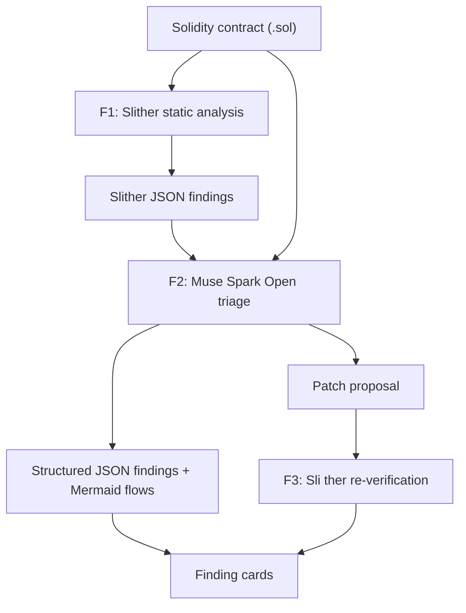

# Sentry Vision

**SentryVision is a standalone smart contract security verifier built for the Meta Hackathon. It analyzes Solidity contracts, identifies vulnerabilities, explains how an exploit would actually happen, and visualizes the attack flow.**

Unlike generic scanners that output cryptic reports, SentryVision combines deterministic static analysis with Meta's Muse Spark Open reasoning to produce structured, auditable, and visual security intelligence.

> Sentry Vision is a triage and visualization tool, **not** a formal security audit. See [Limitations](#limitations).

---

## Why not just Slither, or just an LLM?

- **Slither** is a reliable deterministic detector, but its output is hard to read.
- **LLMs** are easy to read, but they can hallucinate.
- **Sentry Vision combines them:** Slither detects, a Meta model interprets and visualizes, and Slither verifies the fix.

---

## Problem

Developers and non-technical founders usually get one of two things:

- **Dense static-analysis dumps** (for example raw Slither output) that they cannot interpret, or
- **Generic LLM answers** with no deterministic grounding that they cannot trust.

Neither tells them *what is actually dangerous* or *how an attack would really happen*.

## Solution

1. The user pastes or uploads a `.sol` contract.
2. **Slither** runs deterministic static detection (detector, impact, confidence, affected lines).
3. **Muse Spark Open** (Meta's open-weights model) triages the findings: confirms real issues, ranks by exploitability, and explains each issue in plain language.
4. The app returns **structured JSON** and renders a **visual attack flowchart** (Mermaid) for each confirmed finding.
5. The model proposes a **patched version**, and **Slither re-runs on the patch** to check it. The result is labeled "Patch verified by Slither" or "Unverified patch".

**Core differentiation:** not just "find bugs", but *show how the hack would actually happen*, and check the fix with the same deterministic tool.

---

## How it works

| Layer | Role | Engine |
| --- | --- | --- |
| **F1** | Deterministic static signal | Slither |
| **F2** | Triage, plain-language explanation, patch proposal, Mermaid exploit flow | Muse Spark Open (`meta-models/muse-spark-open-1026`) via Baseten |
| **F3** | Patch re-verification (Slither re-check) | Slither on proposed `patched_code` |



### Verification Schema

**F1 - Deterministic Detection:** Slither static analysis on the submitted `.sol` contract produces structured JSON findings.

**F2 - Muse Spark Open Triage:** Meta Muse Spark Open reads both the contract and Slither findings and returns structured JSON findings, plain-language explanations, Mermaid exploit-flow diagrams, and optional patch proposals.

**F3 - Patch verification:** proposed fixes are re-analyzed by Slither before they are labeled verified.

**Presentation (alongside the pipeline):** finding cards with severity, plain language, and Mermaid diagrams. Reasoning-aware parsing validates Muse JSON with Pydantic and one repair retry.

---

## Meta models used

- **Muse Spark Open** (`meta-models/muse-spark-open-1026`), Meta's open-weights model, is the core reasoning engine (via Baseten OpenAI-compatible API).
- **Development:** Muse Spark Open was also used as a coding assistant while building this project.

---

## Tech stack

- **Core AI Engine:** Meta Muse Spark Open via Baseten Inference
- **Static Analysis:** [Slither](https://github.com/crytic/slither) with `solc-select` (Docker image)
- **Backend:** Python, FastAPI, Pydantic
- **Frontend:** HTML / JavaScript with [Mermaid.js](https://mermaid.js.org/)
- **Deployment:** Render (Docker)

---

## Getting started

### Prerequisites

- Python 3.10+ **or** Docker
- Baseten API key for Muse Spark Open

### Setup (local Python)

```bash
git clone https://github.com/chokri29/SentryVision.git
cd SentryVision

python -m venv .venv
source .venv/bin/activate
pip install -r requirements.txt
```

### Configuration

```bash
cp .env.example .env
```

```env
LLM_API_KEY=your_baseten_api_key
LLM_BASE_URL=https://inference.baseten.co/v1
LLM_MODEL=meta-models/muse-spark-open-1026
ENABLE_SLITHER=true
ALLOWED_ORIGINS=http://localhost:8000
```

**Never commit `.env`.** On Render, set the same variables in the service dashboard.

### Run

```bash
# Docker (recommended — includes solc + Slither)
docker build -t sentryvision .
docker run --rm -p 8000:8000 --env-file .env sentryvision

# Or local (Slither optional if installed)
uvicorn main:app --reload --port 8000
```

- UI: http://localhost:8000
- Health: `GET /health`
- API: `POST /analyze` with `{ "solidity_code": "..." }`

---

## Demo for judges (3 clicks)

1. Open the live app (or `http://localhost:8000` after Docker/local start).
2. Click **Reentrancy** (same source as [`examples/01_reentrancy.sol`](examples/01_reentrancy.sol)).
3. Click **Run Meta-assisted Audit**.

**What to look for**

| UI signal | Meaning |
| --- | --- |
| Summary meta line | `Slither findings: N · Patches verified: M · Pipeline: F1 → F2 → F3` |
| Finding severity + plain language | F2 Muse triage grounded in F1 |
| Mermaid flowchart | Visual exploit path (presentation layer) |
| **Patch verified by Slither** (green) | F3: Sli ther no longer reports High/Medium on that patch (not a full audit) |
| **Fix proposed** | Muse returned a full patched contract |

Optional: try **Access Control** and **Unchecked Call**. Source for every button lives under [`examples/`](examples/) so judges can open the same files in the repo.

---

## Regression fixtures (`examples/`)

| File | UI sample | Expected primary issues |
| --- | --- | --- |
| [`01_reentrancy.sol`](examples/01_reentrancy.sol) | Reentrancy | Reentrancy (external call before balance update) |
| [`02_missing_access_control.sol`](examples/02_missing_access_control.sol) | Access Control | Missing access control on `emergencyWithdraw` |
| [`03_unchecked_call.sol`](examples/03_unchecked_call.sol) | Unchecked Call | Unchecked low-level call / CEI-style issues |
| [`04_tx_origin_auth.sol`](examples/04_tx_origin_auth.sol) | — | `tx.origin` authentication |
| [`05_safe_minimal.sol`](examples/05_safe_minimal.sol) | — | Ideally no Critical/High findings |

These contracts are self-contained (no OpenZeppelin imports) so Slither can run in the Docker image. They are **demo / triage fixtures**, not formal audit ground truth. Sample source in the UI matches these files and does **not** include comments that name the vulnerability.

---

## Hackathon progress

Everything in this repository is being built during the hackathon window. An earlier pre-hackathon prototype exists in a separate private repository and is **not** part of this submission.

| Milestone | Status |
| --- | --- |
| FastAPI + Muse Spark Open via Baseten (`/analyze`) | Done |
| UI: finding cards, severity badges, Mermaid flows | Done |
| F1 Slither (Docker image + `solc-select`) | Done |
| F2 Muse triage, plain language, patch proposal | Done |
| F3 Sli ther re-verification on proposed patches | Done |
| Sample contracts (UI buttons + `examples/*.sol`) | Done |
| Live deploy on Render (Docker) | Done |
| Collapsible patches, F3 skip when no patch | Done |
| Demo video | Planned |

The commit history shows when each piece was built.

---

## Limitations

- This is **not a formal audit** and gives no guarantee that a contract is safe.
- Slither can produce false positives, and no static analyzer finds every bug. The model can also be wrong.
- A patch marked "verified by Slither" only means Slither no longer reports High/Medium findings on that patch — not that the original issue is fully gone in every sense, and not that the contract is secure overall.
- Contracts that depend on external imports may not compile when pasted as a single file.
- Always have important contracts reviewed by a professional auditor before deployment.

---

## Roadmap

- Multi-file and import support
- Secure-flow diagram showing the path after the fix
- Upload an architecture screenshot for analysis (Muse Spark Open supports vision)
- Integration into the digital assets security verification project [cryptoreviewlab.com](https://cryptoreviewlab.com) review workflow
- CryptoReviewLab [Repository](https://github.com/chokri29/Crypto-Review-Lab)

---

## Credits

- [Slither](https://github.com/crytic/slither) by Trail of Bits
- [Mermaid.js](https://mermaid.js.org/)
- Meta — Muse Spark Open and the hackathon
- Baseten — inference credits and hosting

## License

MIT (add a `LICENSE` file when ready).

## Author

Chokri AlGhanmi ([@chokri29](https://github.com/chokri29))
