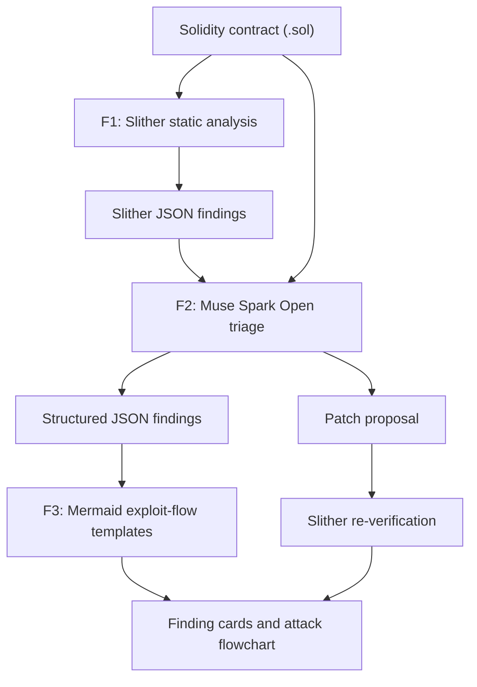

# Sentry Vision

**Slither-grounded, Meta-powered Solidity pre-audit triage for developers and non-technical founders.**

Paste a smart contract. Sentry Vision finds issues with a deterministic static analyzer, uses Meta's Muse Spark Open model to explain what is actually dangerous, and draws how the exploit would unfold.

> Built during the Meta Global AI Developer Hackathon (Oct 26 to Nov 4, 2026). Track: Indie Developer. Theme: Build for Your World.

> Sentry Vision is a triage and visualization tool, **not** a formal security audit. See [Limitations](#limitations).

---

## Why not just Slither, or just an LLM?

- **Slither** is a reliable deterministic detector, but its output is hard to read.
- **LLMs** are easy to read, but they can hallucinate.
- **Sentry Vision combines them:** Slither detects, a Meta model interprets and visualizes, and Slither verifies the fix.

<!-- Add after recording the demo:  -->

<!-- Add once the UI works:  -->

---

## Problem

Developers and non-technical founders usually get one of two things:

- **Dense static-analysis dumps** (for example raw Slither output) that they cannot interpret, or
- **Generic LLM answers** with no deterministic grounding that they cannot trust.

Neither tells them *what is actually dangerous* or *how an attack would really happen*.

## Solution

1. The user pastes or uploads a `.sol` contract.
2. **Slither** runs deterministic static detection (detector, impact, confidence, affected lines).
3. **Muse Spark Open** (Meta's open-weights model) triages the findings: confirms real issues, marks likely false positives with reasons, ranks by exploitability, and explains each issue in plain language.
4. The app returns **structured JSON** and renders a **visual attack flowchart** (Mermaid) for each confirmed finding.
5. The model proposes a **patched version**, and **Slither re-runs on the patch** to check it. The result is labeled "Patch verified by Slither" or "Unverified patch".

**Core differentiation:** not just "find bugs", but *show how the hack would actually happen*, and check the fix with the same deterministic tool.

---

## How it works

| Layer | Role | Engine |
| --- | --- | --- |
| **F1** | Deterministic static signal | Slither |
| **F2** | Triage, false-positive review, plain-language explanation, patch proposal | Muse Spark Open (`meta-models/muse-spark-open-1026`) via Baseten |
| **F3** | Visual exploit path | Mermaid.js, built from fixed templates per vulnerability type |



### Design goals

These describe how the app is designed to work. The [progress table](#hackathon-progress) shows what is implemented so far.

- **Slither first, model second.** Findings come from a deterministic tool. The model explains and prioritizes them instead of inventing them.
- **Nothing is silently dropped.** Findings the model considers noise are shown as "Likely false positive" with its reasoning, collapsed by default.
- **Labeled sources.** Each finding is marked "Confirmed by Slither" or "AI-suspected", so the user can see what is deterministic and what is not.
- **Reliable diagrams.** The structure of each Mermaid diagram comes from a fixed template (reentrancy, missing access control, unchecked call, and so on). The model fills in only function and variable names, which avoids the syntax errors that free-form model-written diagrams cause.
- **Verified patches.** A proposed fix is re-analyzed by Slither before it is presented as verified.
- **Reasoning-aware parsing.** Muse Spark Open always reasons before answering. The backend reads only the final answer, validates it against the JSON schema, and retries once with a repair prompt if validation fails.
- **Graceful fallback.** If a contract cannot be compiled (for example, because of missing imports), the app says static analysis is unavailable and falls back to a clearly labeled model-only review.

### Target output schema

Illustrative shape of the structured JSON (field names may change during development):

```json
{
  "summary": "One-paragraph plain-language verdict.",
  "findings": [
    {
      "id": "F-001",
      "title": "Reentrancy in claim()",
      "severity": "high",
      "source": "slither",
      "detector": "reentrancy-eth",
      "verdict": "confirmed",
      "lines": [24, 31],
      "what_happens": "Plain-language description of the exploit.",
      "why_it_matters": "Impact for the project and its users.",
      "what_to_do": "Recommended fix.",
      "attack_flow": {
        "template": "reentrancy",
        "params": { "contract": "Payout", "function": "claim", "variable": "owed" }
      },
      "patch": { "code": "...", "verified_by_slither": true }
    }
  ]
}
```

`verdict` is one of `confirmed`, `likely_false_positive`, or `ai_suspected`.

---

## Meta models used

- **Muse Spark Open** (`meta-models/muse-spark-open-1026`), Meta's open-weights model, is the core reasoning engine. It is served through Baseten's OpenAI-compatible inference API and handles triage, false-positive reasoning, plain-language explanations, and patch proposals.
- **Development:** Muse Spark Open through the Meta Model API was also used as a coding assistant while building this project. [TODO: confirm this is accurate before submitting, or delete this line]

---

## Tech stack

- **Backend:** Python, FastAPI
- **Static analysis:** [Slither](https://github.com/crytic/slither) with `solc-select` for compiler versions
- **LLM access:** Muse Spark Open via Baseten's OpenAI-compatible API (OpenAI Python SDK)
- **Frontend:** HTML and JavaScript with [Mermaid.js](https://mermaid.js.org/)
- **Deployment:** Docker on Render

---

## Getting started

### Prerequisites

- Python 3.10 or newer
- An API key with access to Muse Spark Open (the hackathon uses Baseten)

### Setup

```bash
git clone https://github.com/chokri29/SentryVision.git
cd SentryVision

python -m venv .venv
source .venv/bin/activate        # Windows: .venv\Scripts\activate
pip install -r requirements.txt

# Install the Solidity compiler versions you need
solc-select install 0.8.20
solc-select use 0.8.20
```

### Configuration

Copy the example file and fill in your own values:

```bash
cp .env.example .env
```

```
LLM_API_KEY=your_key_here
LLM_BASE_URL=https://inference.baseten.co/v1
LLM_MODEL=meta-models/muse-spark-open-1026
```

`LLM_MODEL` must match the model ID your key is allowed to call. **Never commit `.env`.** It is listed in `.gitignore`. On Render, set these values as environment variables in the dashboard.

### Run

```bash
uvicorn main:app --reload
```

Then open the app in your browser, paste a contract, and run the analysis.

---

## Hackathon progress

Everything in this repository was built from scratch during the hackathon window. An earlier pre-hackathon prototype exists in a separate repository and is **not** part of this submission.

| Milestone | Status |
| --- | --- |
| FastAPI endpoint and Muse Spark Open call (via Baseten) | In progress |
| Slither runner and JSON parsing | Planned |
| Model triage (confirmed or likely false positive) | Planned |
| Mermaid exploit-flow templates | Planned |
| Patch generation and Slither re-verification | Planned |
| Sample contracts, tests, and deployment | Planned |
| Demo video | Planned |

The commit history shows when each piece was built.

---

## Limitations

- This is **not a formal audit** and gives no guarantee that a contract is safe.
- Slither can produce false positives, and no static analyzer finds every bug. The model can also be wrong.
- A patch marked "verified by Slither" only means Slither no longer reports the original findings, not that the contract is secure.
- Contracts that depend on external imports may not compile when pasted as a single file.
- Always have important contracts reviewed by a professional auditor before deployment.

---

## Roadmap

- Multi-file and import support
- Secure-flow diagram showing the exploit path after the fix
- Upload an architecture screenshot for analysis (Muse Spark Open supports vision)
- Integration into the [Crypto Review Lab](https://cryptoreviewlab.com) review workflow

---

## Credits

- [Slither](https://github.com/crytic/slither) by Trail of Bits (see its repository for license terms)
- [Mermaid.js](https://mermaid.js.org/)
- Meta, for Muse Spark Open and the hackathon
- Baseten, for inference credits and hosting

## License

MIT. See `LICENSE`.

## Author

Chokri ([@chokri29](https://github.com/chokri29))
