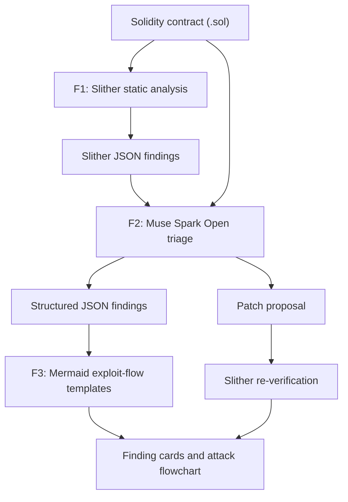

# Sentry Vision

**SentryVision is a standalone smart contract security verifier built for the Meta Hackathon. It analyzes Solidity contracts, identifies vulnerabilities, explains how an exploit would actually happen, and visualizes the attack flow.**

Unlike generic scanners that output cryptic reports, SentryVision combines deterministic static analysis with Meta's Muse Spark Open reasoning to produce structured, auditable, and visual security intelligence.

> Sentry Vision is a triage and visualization tool, **not** a formal security audit. See [Limitations](#limitations).

---

## Why not just Slither, or just an LLM?

- **Slither** is a reliable deterministic detector, but its output is hard to read.
- **LLMs** are easy to read, but they can hallucinate.
- **Sentry Vision combines them:** Slither detects, a Meta model interprets and visualizes, and Slither verifies the fix.

<!-- Add after recording the demo:  -->

<!-- Add once the UI works:  -->

---

## Problem

Developers and non-technical founders usually get one of two things:

- **Dense static-analysis dumps** (for example raw Slither output) that they cannot interpret, or
- **Generic LLM answers** with no deterministic grounding that they cannot trust.

Neither tells them *what is actually dangerous* or *how an attack would really happen*.

## Solution

1. The user pastes or uploads a `.sol` contract.
2. **Slither** runs deterministic static detection (detector, impact, confidence, affected lines).
3. **Muse Spark Open** (Meta's open-weights model) triages the findings: confirms real issues, marks likely false positives with reasons, ranks by exploitability, and explains each issue in plain language.
4. The app returns **structured JSON** and renders a **visual attack flowchart** (Mermaid) for each confirmed finding.
5. The model proposes a **patched version**, and **Slither re-runs on the patch** to check it. The result is labeled "Patch verified by Slither" or "Unverified patch".

**Core differentiation:** not just "find bugs", but *show how the hack would actually happen*, and check the fix with the same deterministic tool.

---

## How it works

| Layer | Role | Engine |
| --- | --- | --- |
| **F1** | Deterministic static signal | Slither |
| **F2** | Triage, false-positive review, plain-language explanation, patch proposal | Muse Spark Open (`meta-models/muse-spark-open-1026`) via Baseten |
| **F3** | Visual exploit path | Mermaid.js, built from fixed templates per vulnerability type |



### Verification Schema

SentryVision uses a 3-stage verification pipeline:

**F1 - Deterministic Detection:** Slither static analysis on the submitted `.sol` contract produces structured JSON findings.

**F2 - Muse Spark Open Triage:** Meta Muse Spark Open (`meta-models/muse-spark-open-1026` via Baseten) reads both the contract and Slither findings, performs reasoning, and returns structured JSON findings and a patch proposal.

**F3 - Presentation & Verification:**
- Structured findings are mapped to deterministic Mermaid exploit-flow templates
- Reasoning-Aware Parsing: The backend reads only the model's final answer, validates it against a Pydantic JSON schema, and retries once with a repair prompt if validation fails
- Verified Patches: Any proposed fix is re-analyzed by Slither before it is presented as verified. Unverified patches are explicitly labeled as such.

Final output is a Finding Card with severity, plain-language explanation, and a visual attack flowchart. 

### Target output schema

Illustrative shape of the structured JSON (field names may change during development):

```json
{
  "summary": "One-paragraph plain-language verdict.",
  "findings": [
    {
      "id": "F-001",
      "title": "Reentrancy in claim()",
      "severity": "high",
      "source": "slither",
      "detector": "reentrancy-eth",
      "verdict": "confirmed",
      "lines": [24, 31],
      "what_happens": "Plain-language description of the exploit.",
      "why_it_matters": "Impact for the project and its users.",
      "what_to_do": "Recommended fix.",
      "attack_flow": {
        "template": "reentrancy",
        "params": { "contract": "Payout", "function": "claim", "variable": "owed" }
      },
      "patch": { "code": "...", "verified_by_slither": true }
    }
  ]
}
```

`verdict` is one of `confirmed`, `likely_false_positive`, or `ai_suspected`.

---

## Meta models used

- **Muse Spark Open** (`meta-models/muse-spark-open-1026`), Meta's open-weights model, is the core reasoning engine. It is served through Baseten's OpenAI-compatible inference API and handles triage, false-positive reasoning, plain-language explanations, and patch proposals.
- **Development:** Muse Spark Open through the Meta Model API used also as a coding assistant while building this project.

---

## Tech stack

- **Core AI Engine:** Meta Muse Spark Open (`meta-models/muse-spark-open-1026`) via Baseten Inference (`https://inference.baseten.co/v1`)
- **Static Analysis:** 
[Slither](https://github.com/crytic/slither) The Static Analyzer for Solidity, with `solc-select` for compiler versions (planned)
- **Backend:** Python, FastAPI, Pydantic
- **Frontend:** 
HTML and JavaScript with [Mermaid.js](https://mermaid.js.org/)
- **Output:** Structured JSON Vulnerabilities Report.
- **Deployment:** Render (single service)

---

## Getting started

### Prerequisites

- Python 3.10 or newer
- An API key with access to Muse Spark Open (hackathon: Baseten)

### Setup

```bash
git clone https://github.com/chokri29/SentryVision.git
cd SentryVision

python -m venv .venv
source .venv/bin/activate        # Windows: .venv\Scripts\activate
pip install -r requirements.txt
```

### Configuration

```bash
cp .env.example .env
```

```env
API_KEY=your_baseten_api_key
BASE_URL=https://inference.baseten.co/v1
MODEL_NAME=meta-models/muse-spark-open-1026
ALLOWED_ORIGINS=http://localhost:8000
```

`MODEL_NAME` must match the model ID your key can call. **Never commit `.env`.** On Render, set the same variables in the service dashboard.

### Run

```bash
uvicorn main:app --reload --port 8000
```

- UI: [http://localhost:8000](http://localhost:8000) (requires `index.html`)
- API: `POST /analyze` with `{ "solidity_code": "..." }`

---

## Hackathon progress

Everything in this repository is being built during the hackathon window. An earlier pre-hackathon prototype exists in a separate private repository and is **not** part of this submission.

| Milestone | Status |
| --- | --- |
| FastAPI endpoint and Muse Spark Open call (via Baseten) | Done (env-based client + `/analyze`) |
| Basic UI (`index.html`) | Done |
| Slither runner and JSON parsing | Done |
| Model triage (confirmed or likely false positive) | Done |
| Mermaid exploit-flow templates | Planned |
| Patch generation and Slither re-verification | Planned |
| Sample contracts, tests, and deployment | Planned |
| Demo video | Planned |

The commit history shows when each piece was built.

---

## Limitations

- This is **not a formal audit** and gives no guarantee that a contract is safe.
- Slither can produce false positives, and no static analyzer finds every bug. The model can also be wrong.
- A patch marked "verified by Slither" only means Slither no longer reports the original findings, not that the contract is secure.
- Contracts that depend on external imports may not compile when pasted as a single file.
- Always have important contracts reviewed by a professional auditor before deployment.

---

## Roadmap

- Multi-file and import support
- Secure-flow diagram showing the path after the fix
- Upload an architecture screenshot for analysis (Muse Spark Open supports vision)
- Integration into the digital assets security verification project [cryptoreviewlab.com](https://cryptoreviewlab.com) review workflow
- CryptoReviewLab [Repository](https://github.com/chokri29/Crypto-Review-Lab)

---

## Credits

- [Slither](https://github.com/crytic/slither) by Trail of Bits
- [Mermaid.js](https://mermaid.js.org/)
- Meta — Muse Spark Open and the hackathon
- Baseten — inference credits and hosting

## License

MIT (add a `LICENSE` file when ready).

## Author

Chokri AlGhanmi ([@chokri29](https://github.com/chokri29))
