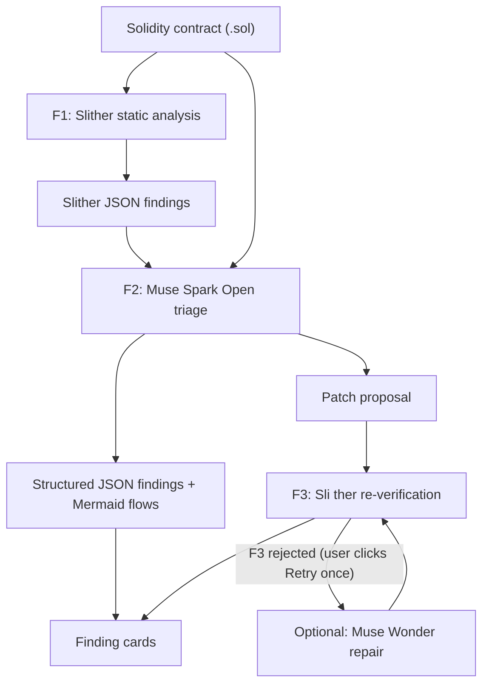

# Sentry Vision

**SentryVision is a standalone smart contract security verifier built for the Meta Hackathon. It analyzes Solidity contracts, identifies vulnerabilities, explains how an exploit would actually happen, and visualizes the attack flow.**

Unlike generic scanners that output cryptic reports, SentryVision combines deterministic static analysis with Meta's Muse Spark Open (and optional Muse Wonder on repair) to produce structured, auditable, and visual security intelligence.

> Sentry Vision is a triage and visualization tool, **not** a formal security audit. See [Limitations](#limitations).

---

## Why not just Slither, or just an LLM?

- **Slither** is a reliable deterministic detector, but its output is hard to read.
- **LLMs** are easy to read, but they can hallucinate.
- **Sentry Vision combines them:** Slither detects, Muse Spark Open interprets and visualizes, Slither re-checks the proposed fix, and optional Muse Wonder retries a rejected patch once.

---

## Problem

Developers and non-technical founders usually get one of two things:

- **Dense static-analysis dumps** (for example raw Slither output) that they cannot interpret, or
- **Generic LLM answers** with no deterministic grounding that they cannot trust.

Neither tells them *what is actually dangerous* or *how an attack would really happen*.

## Solution

1. The user pastes or uploads a `.sol` contract.
2. **Slither** runs deterministic static detection (detector, impact, confidence, affected lines).
3. **Muse Spark Open** triages the findings in plain language and proposes a patch.
4. The app returns **structured JSON** and renders a **visual attack flowchart** (Mermaid).
5. **Slither re-runs on the patch** and a **public signature surface check** runs.
6. If F3 rejects the patch, the user can **retry once** (Muse Wonder when configured).

**Core differentiation:** not just "find bugs", but *show how the hack would happen*, and check the fix with the same deterministic tool — without claiming a formal audit.

---

## How it works

| Layer | Role | Engine |
| --- | --- | --- |
| **F1** | Deterministic static signal | Slither |
| **F2** | Triage, explanation, patch, Mermaid | Muse Spark Open via Baseten |
| **F3** | Patch re-scan + surface check | Slither + signature surface |
| **Retry** (optional) | One user-triggered repair if F3 rejects | Muse Wonder through Meta Model API, using separate `LLM_RETRY_API_KEY` credentials |




### Verification claim (honest)

Green **Passed Slither re-scan + surface check** means:

1. The patch **compiles** under the pinned solc.
2. Slither reports **no High/Medium** on the patch.
3. Every original public/external entry point **name + parameter types** (plus `receive`/`fallback`) is still present.
4. The behaviour-lite check rejects clear empty or always-reverting bodies when the original entry point had non-gutted logic.

It does **not** mean the contract is safe, that behaviour is preserved, or that Low/Informational issues are gone.

### Vendored OpenZeppelin (subset)

F1 can resolve only the documented `SUPPORTED_OZ_IMPORTS` list through `vendor/openzeppelin/`, a **vendored OZ subset** of hand-written stubs. The stubs use **pre-5.0 style** patterns but are not a copy of a specific upstream version, are not audited upstream code, and are not claimed equivalent to real OZ. Unknown imports fail closed to **Model-only result — not verified**. Expand the supported list only on demand.

### Bounded self-heal (optional retry)

When F3 **rejects** a real patch (`still_vulnerable`, `compile_failed`, `surface_removed`, `gutted_function`, or `regression_introduced`), the UI can offer **one** user-triggered retry:

| Piece | Behavior |
| --- | --- |
| **Trigger** | User clicks **Retry patch once** (never auto) |
| **Server state** | Redis-backed `meta.analysis_id` — original source + findings with a 1h TTL; local in-memory fallback is for development only |
| **Endpoint** | `POST /analyze/{analysis_id}/retry-patch` |
| **Cap** | `MAX_PATCH_RETRIES=1` server-side |
| **Retry model** | Muse Wonder (`muse-wonder-1.0`) via Meta Model API; retry is enabled only when `LLM_RETRY_API_KEY` is configured |
| **Optional Wonder** | Set `LLM_RETRY_API_KEY`, `LLM_RETRY_BASE_URL`, and `LLM_RETRY_MODEL`; separate Meta client, never the Baseten key. Without the Meta key, the retry action stays unavailable |

Retry does **not** run on identical patches, empty patches, or pure infra failures. The pass label means only the claim above — not "safe to deploy."

### Production usage protection and privacy

For a multi-worker Render deployment, configure a shared Redis service (use a TLS `rediss://` URL):

- `REDIS_URL`: shared Redis connection URL. Retry state is stored with `ANALYSIS_TTL_SECONDS` expiry and shared across workers/restarts.
- `REQUIRE_SHARED_STORAGE=true`: refuse analysis persistence if Redis is absent; do not silently fall back to process memory.
- `REQUIRE_REDIS_RATE_LIMIT=true`: fail closed if shared usage protection is unavailable.
- `MAX_DAILY_AI_CALLS=100`: global daily cap across analysis and retry calls, enforced atomically in Redis.
- `MAX_PATCH_RETRIES=1`: server-enforced retry limit, now read from the environment.
- `TRUST_CF_CONNECTING_IP=true`: use only the single-value `CF-Connecting-IP` header supplied by the trusted Cloudflare edge. Confirm this header is present and overwritten by the edge on the deployed Render URL before enabling it. Otherwise the app falls back to the socket peer; it never trusts client-supplied `X-Forwarded-For`.
- `RATE_LIMIT_HMAC_KEY`: optional dedicated secret used to pseudonymize IP addresses in Redis rate-limit keys.

The six-requests-per-minute per-client limit and daily AI-call cap are distributed when Redis is configured. Without Redis, development uses process-local limits and retry state; these are not suitable for multi-worker production. Redis contains submitted source temporarily for the optional retry, so use an access-controlled TLS endpoint and an appropriate retention policy.

**Provider disclosure:** Solidity source is sent to Baseten for Muse Spark analysis. If the user explicitly requests the optional retry, the original source and patch context are sent to Meta's Model API for Muse Wonder. Do not submit private keys, credentials, or other secrets.

## Meta models used

- **Muse Spark Open** — default F2 triage / patch proposal.
- **Muse Wonder** (optional) — stronger one-shot repair on user-triggered retry.

## Tech stack

- Meta Muse Spark Open via Baseten (F2); optional Muse Wonder via Meta Model API with separate credentials (retry)
- [Slither](https://github.com/crytic/slither) + `solc-select` (Docker)
- Python, FastAPI, Pydantic
- HTML / JS + [Mermaid.js](https://mermaid.js.org/)
- Render (Docker)

## Getting started

```bash
git clone https://github.com/chokri29/SentryVision.git
cd SentryVision
cp .env.example .env   # set Baseten LLM_API_KEY; optionally set separate Meta LLM_RETRY_API_KEY
docker build -t sentryvision .
docker run --rm -p 8000:8000 --env-file .env sentryvision
```

- UI: http://localhost:8000
- Health: `GET /health`
- Analyze: `POST /analyze`
- Retry: `POST /analyze/{analysis_id}/retry-patch` (max 1)

## Demo for judges

1. Open the live app.
2. Click **Reentrancy** → **Run Meta-assisted Audit**.
3. Look for pipeline label, findings, Mermaid, and the green **Passed Slither re-scan + surface check** badge (or an honest failure / model-only label).

## Limitations

- Not a professional audit.
- F3 claim is compile + Slither re-scan clean (no High/Medium) + name + parameter types surface preserved + behaviour-lite passed. It does not establish behavioural preservation or security.
- A green pytest suite is test evidence, not proof of complete verification.
- OZ support is a **vendored OZ subset** with documented supported import paths; it is not audited upstream code and is not claimed equivalent to real OpenZeppelin.
- Production retry state and global usage budgets require a configured shared Redis instance; process-local fallback is development-only.\n- Solidity source is transmitted to Baseten for analysis and to Meta only when a user requests the optional Muse Wonder retry.

## Credits

- [Slither](https://github.com/crytic/slither) by Trail of Bits
- [Mermaid.js](https://mermaid.js.org)
- [Meta](https://ai.meta.com) — Muse Spark Open + Meta Wonder 
- [Baseten](https://baseten.co) — inference credits and hosting

## License

[MIT](https://github.com/chokri29/SentryVision/blob/main/LICENSE).

## Author

Chokri AlGhanmi ([@chokri29](https://github.com/chokri29))


