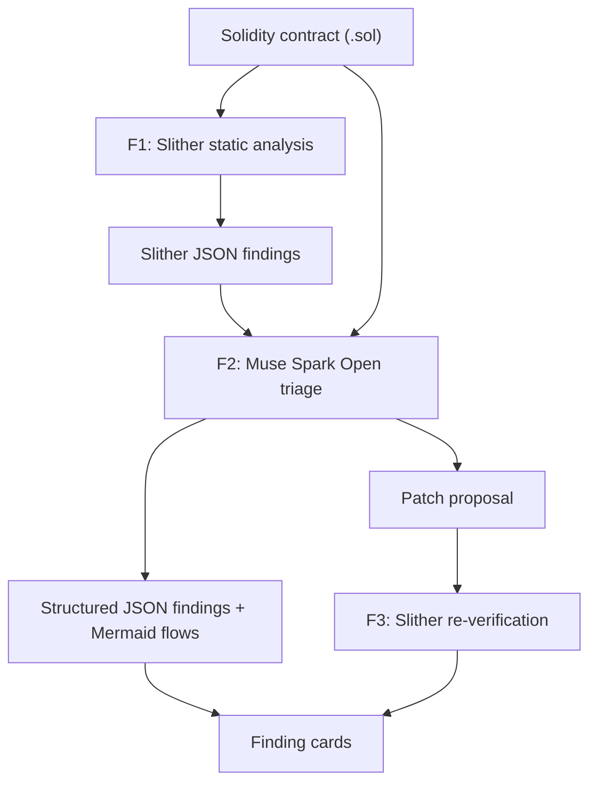

# Sentry Vision

**SentryVision is a standalone smart contract security verifier built for the Meta Hackathon. It analyzes Solidity contracts, identifies vulnerabilities, explains how an exploit would actually happen, and visualizes the attack flow.**

Unlike generic scanners that output cryptic reports, SentryVision combines deterministic static analysis with Meta's Muse Spark Open reasoning to produce structured, auditable, and visual security intelligence.

> Sentry Vision is a triage and visualization tool, **not** a formal security audit. See [Limitations](#limitations).

---

## Why not just Slither, or just an LLM?

- **Slither** is a reliable deterministic detector, but its output is hard to read.
- **LLMs** are easy to read, but they can hallucinate.
- **Sentry Vision combines them:** Slither detects, a Meta model interprets and visualizes, and Slither verifies the fix.

---

## Problem

Developers and non-technical founders usually get one of two things:

- **Dense static-analysis dumps** (for example raw Sli ther output) that they cannot interpret, or
- **Generic LLM answers** with no deterministic grounding that they cannot trust.

Neither tells them *what is actually dangerous* or *how an attack would really happen*.

## Solution

1. The user pastes or uploads a `.sol` contract.
2. **Slither** runs deterministic static detection (detector, impact, confidence, affected lines).
3. **Muse Spark Open** (Meta's open-weights model) triages the findings: confirms real issues, ranks by exploitability, and explains each issue in plain language.
4. The app returns **structured JSON** and renders a **visual attack flowchart** (Mermaid) for each confirmed finding.
5. The model proposes a **patched version**, and **Slither re-runs on the patch** to check it. The result is labeled "Patch verified by Slither" or "Unverified patch".

**Core differentiation:** not just "find bugs", but *show how the hack would actually happen*, and check the fix with the same deterministic tool.

---

## How it works

| Layer | Role | Engine |
| --- | --- | --- |
| **F1** | Deterministic static signal | Slither |
| **F2** | Triage, plain-language explanation, patch proposal, Mermaid exploit flow | Muse Spark Open (`meta-models/muse-spark-open-1026`) via Baseten |
| **F3** | Patch re-verification (Slither re-check) | Slither on proposed `patched_code` |



### Verification Schema

**F1 - Deterministic Detection:** Slither static analysis on the submitted `.sol` contract produces structured JSON findings.

**F2 - Muse Spark Open Triage:** Meta Muse Spark Open reads both the contract and Slither findings and returns structured JSON findings, plain-language explanations, Mermaid exploit-flow diagrams, and optional patch proposals.

**F3 - Patch verification:** proposed fixes are re-analyzed by Slither before they are labeled verified.

**Presentation (alongside the pipeline):** finding cards with severity, plain language, and Mermaid diagrams. Reasoning-aware parsing validates Muse JSON with Pydantic and one repair retry.

When F1 cannot run (compile failure, Slither unavailable, or Slither disabled), the UI meta line reports **Pipeline: F2 only (static analysis unavailable)** instead of implying a full F1 → F2 → F3 path.

### Bounded self-heal (optional retry)

When F3 **rejects** a real patch (`still_vulnerable`, `compile_failed`, or `regression_introduced`), the UI can offer **one** user-triggered retry:

| Piece | Behavior |
| --- | --- |
| **Trigger** | User clicks **Retry patch once** (never auto) |
| **Server state** | `meta.analysis_id` — original source + findings stored in memory (~1h TTL) |
| **Endpoint** | `POST /analyze/{analysis_id}/retry-patch` |
| **Cap** | `MAX_PATCH_RETRIES=1` enforced server-side |
| **Default model** | Muse Spark (same as F2) |
| **Optional Wonder** | Set `LLM_RETRY_MODEL` / `LLM_WONDER_MODEL` to a Muse Wonder id — pill turns green only when configured |

Retry does **not** run on identical patches, empty patches, or pure infra failures (`timeout` / `slither_unavailable`). Invalid retry JSON does not burn the one attempt. Verified still means “Slither no longer reports that High/Medium issue,” not “safe to deploy.”

## Meta models used

- **Muse Spark Open** (`meta-models/muse-spark-open-1026`) — default F2 triage / patch proposal (Baseten OpenAI-compatible API).
- **Muse Wonder** (optional) — stronger one-shot repair on user-triggered retry when `LLM_RETRY_MODEL` is set.
- **Development:** Muse tools were also used as coding assistants while building this project.

---

## Tech stack

- **Core AI Engine:** Meta Muse Spark Open via Baseten Inference
- **Static Analysis:** [Slither](https://github.com/crytic/slither) with `solc-select` (Docker image)
- **Backend:** Python, FastAPI, Pydantic
- **Frontend:** HTML / JavaScript with [Mermaid.js](https://mermaid.js.org/)
- **Deployment:** Render (Docker)

---

## Getting started

### Prerequisites

- Python 3.10+ **or** Docker
- Baseten API key for Muse Spark Open

### Setup (local Python)

```bash
git clone https://github.com/chokri29/SentryVision.git
cd SentryVision

python -m venv .venv
source .venv/bin/activate
pip install -r requirements.txt
```

### Configuration

```bash
cp .env.example .env
```

```env
LLM_API_KEY=your_baseten_api_key
LLM_BASE_URL=https://inference.baseten.co/v1
LLM_MODEL=meta-models/muse-spark-open-1026
# Optional: Muse Wonder for the single self-heal retry
# LLM_RETRY_MODEL=meta-models/<muse-wonder-id>
ENABLE_SLITHER=true
ALLOWED_ORIGINS=http://localhost:8000
```

**Never commit `.env`.** On Render, set the same variables in the service dashboard.

### Run

```bash
# Docker (recommended — includes solc + Slither)
docker build -t sentryvision .
docker run --rm -p 8000:8000 --env-file .env sentryvision

# Or local (Slither optional if installed)
uvicorn main:app --reload --port 8000
```

- UI: http://localhost:8000
- Health: `GET /health`
- API: `POST /analyze` with `{ "solidity_code": "..." }`
- Retry: `POST /analyze/{analysis_id}/retry-patch` (max 1; requires prior `/analyze`)

---

## Demo for judges (3 clicks)

1. Open the live app (or `http://localhost:8000` after Docker/local start).
2. Click **Reentrancy** (same source as [`examples/01_reentrancy.sol`](examples/01_reentrancy.sol)).
3. Click **Run Meta-assisted Audit**.

**What to look for**

| UI signal | Meaning |
| --- | --- |
| Summary meta line | Counts + pipeline label (`F1 → F2 → F3`, or `F2 only` if Slither could not run) |
| Finding severity + plain language | F2 Muse triage grounded in F1 |
| Mermaid flowchart | Visual exploit path (presentation layer) |
| **Patch verified by Slither** (green) | F3: Sli ther no longer reports High/Medium on that patch (not a full audit) |
| **Patch failed Slither re-check** | F3 rejected the proposed fix — verification can say no |
| **Fix proposed** | Muse returned a full patched contract |
| **Retry patch once** (amber bar) | F3 failed → one user-triggered repair + F3 again |

Optional: try **Access Control** and **Unchecked Call**. Source for every button lives under [`examples/`](examples/) so judges can open the same files in the repo.

---

## Project status

| Item | Status |
| --- | --- |
| FastAPI + Muse Spark Open via Baseten (`/analyze`) | Done |
| Bounded self-heal (`analysis_id`, max 1 retry) | Done |
| Slither F1 + F3 in Docker | Done |
| UI status pills + honest Wonder labeling | Done |

## Limitations

- Not a substitute for a professional audit.
- F3 “verified” is detector-scoped (Slither High/Medium), not a proof of safety.
- Retry state is **in-memory** (lost on restart / multi-instance).
- Multi-file repos and agentic tool loops are out of scope for this demo.

## License

MIT
